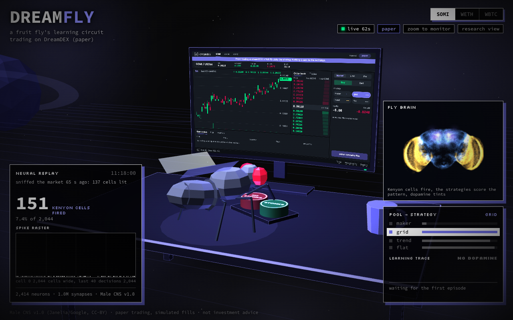
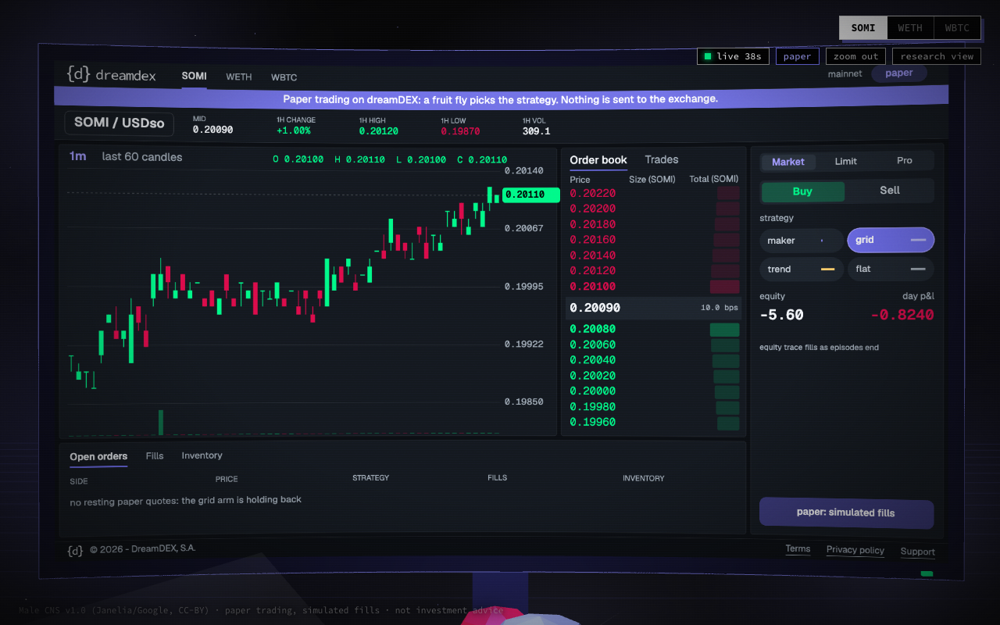
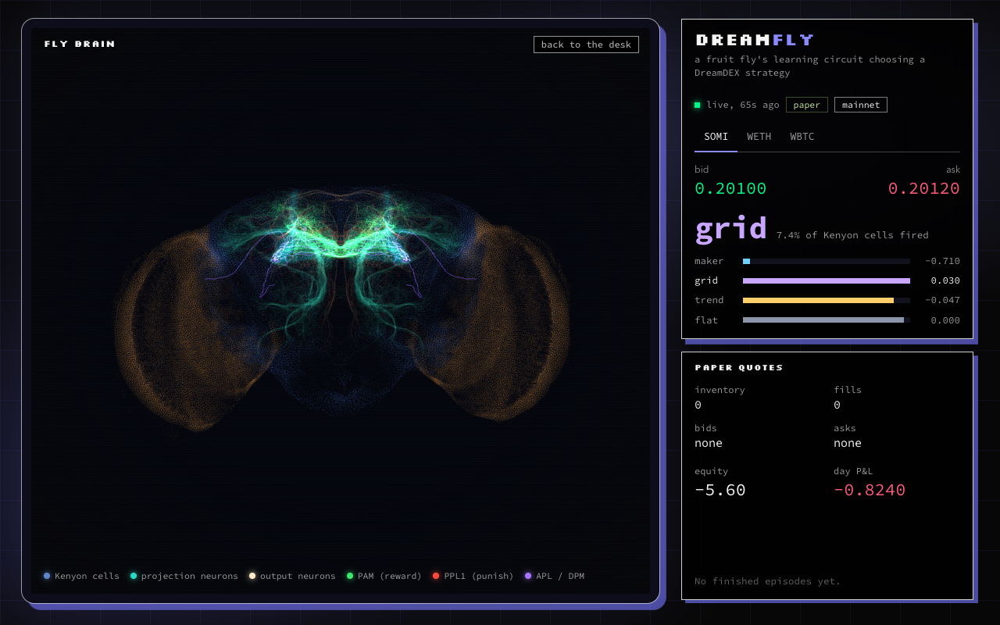
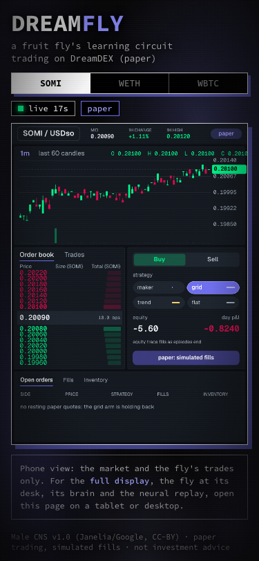

<p align="center">
  
</p>

# DreamFly

<p>
  
  
  
  
  
  
  
  
  
</p>

A fruit fly's learning circuit chooses which risk-bounded trading strategy runs on
[DreamDEX](https://docs.dreamdex.io). The circuit is the mushroom body, wired from the Male CNS v1.0 connectome.
This kit gives you the model, a dry-run and live spot order path built on the DreamDEX bot kit's client, a
dashboard where you watch your fly trade, and a container you can deploy on Railway.

> **The default is safe.** Testnet, dry run: the fly writes down the orders it would place and sends nothing.
> Real orders need `DRY_RUN=false` and a key, and on mainnet also `MAINNET_CONFIRM=yes`. Read
> [DISCLAIMER.md](DISCLAIMER.md) first. No edge is claimed.

## What's inside

| Path | What it is |
| --- | --- |
| [`flybot/mb`](flybot/mb) | The mushroom body from the connectome: a rate model with dopamine-gated learning. |
| [`flybot`](flybot) | Market features, strategies, selectors (fly, bandit, rule, random), backtest loop, perp and event contract logic. |
| [`flybot/live`](flybot/live) | Recorder, paper execution, the order mirror (dry run and live), per-instrument flies, the runner and the supervisor. |
| [`site`](site) | The dashboard: a fly at a desk, a paper terminal, a neural replay and brain panels. Shows only the markets you run. |
| [`perp`](perp) | Node sidecars: read-only recorders for perps and event contracts, and the perp and event contract order executors. |
| [`config`](config) | Tuned strategy parameters and warm-started brains, so a fresh install does not start blank. |
| [`docs`](docs) | [Getting started](docs/getting-started.md), [configuration](docs/configuration.md), [live trading](docs/live-trading.md), [architecture](docs/architecture.md), [Railway](docs/railway.md). |
| [`Dockerfile`](Dockerfile), [`railway.toml`](railway.toml) | One container: the fly, the order mirror and the dashboard. |

Unlike the bot kit, this repo includes a dashboard, so you can watch your fly instead of reading logs.

## Quick start

```bash
git clone https://github.com/somnia-chain/dreamdex-dreamfly && cd dreamdex-dreamfly
uv venv .venv && uv pip install --python .venv/bin/python -e ".[dev]"
source .venv/bin/activate

cp .env.example .env        # testnet, dry run, MARKETS=WETH:USDso
dreamfly doctor             # read-only check of settings, data and the DreamDEX API
dreamfly start              # then open http://localhost:8765
```

The circuit data, tuned parameters and warm-started brains are bundled, so there is nothing to download.

**Dry run** is the default: the order log is `state/live/<market>/orders.jsonl`. **Live** spot orders:

```bash
uv pip install --python .venv/bin/python -e ".[live]"     # adds the DreamDEX core client
# in .env: DRY_RUN=false, PRIVATE_KEY=0x..., and for mainnet MAINNET_CONFIRM=yes
dreamfly doctor --wallet
dreamfly start
```

Read [docs/live-trading.md](docs/live-trading.md) before you do that. In this version the fly learns from a
simulated episode even when orders are live, and live orders are spot only.

**Deploy on Railway** (the worker serves the dashboard too): [docs/railway.md](docs/railway.md).

## What it trades

Each instrument has its own fly with its own weights. They do not share learning.

| Instrument | Venue data | Flies | Strategies | Orders |
|---|---|---|---|---|
| Spot (SOMI, WBTC, WETH) | public REST and WebSocket | one per market | maker, grid, trend, flat | dry run or live |
| Perpetuals (all 21 Hideki markets, or a list) | Hideki testnet (`NETWORK=hideki`), read-only recorder | one per market | p_maker, p_trend, p_carry, flat | dry run or live |
| Event contracts (BTC and ETH Up/Down, 5 m, 15 m, 1 h) | mainnet, read-only recorder | one for all windows | ec_late, ec_sharp, flat | dry run or live (mainnet) |

## How it works

- **The circuit.** Projection neurons feed Kenyon cells, Kenyon cells feed output neurons, and dopamine neurons
  teach the output neurons. Kenyon cell sparsity is set by solving the inhibitory feedback exactly.
- **The selector.** Market features (volatility, trend, time of day and so on) become an odour. The Kenyon cells
  that fire say which strategy to run. The fly never invents a strategy. It only chooses among ours, and it can
  always choose flat.
- **The reward.** Each finished episode returns its risk-adjusted profit as dopamine. A running scale keeps the
  signal near plus or minus one.
- **Two ways to learn from it** (`BRAIN`). The default, `delta`, keeps what each strategy is worth for each kind
  of market state: dopamine carries the surprise, reward minus what the strategy was expected to earn, so a
  strategy can be good in one state and bad in another. It starts from brains replayed over recorded candles.
  `mb` is the original rule, dopamine-gated depression of the Kenyon cell to output synapses only. It never
  learned to switch on a mock market with known regimes (`scripts/mock_regimes.py`), which is why `delta` is the default.
- **Model choices** (ours, not the fly's): one hemisphere, rate units, synapse sign from the predicted
  transmitter, each output neuron taught by the dopamine neurons that synapse onto it, valence opposite to its
  dopamine input (Aso et al. 2014), and for `mb` dopamine-gated depression (Jiang and Litwin-Kumar 2021).

More in [docs/architecture.md](docs/architecture.md).

## The dashboard

A 3D scene: a low-poly fly at a desk, watching a paper terminal and pressing a button for each decision. A neural
replay panel shows which Kenyon cells fired, a small brain panel shows the areas lighting up, and a readout shows
which strategy pool won.

- Tabs switch between the flies you run. Run one market and you see one.
- Zoom to monitor hides the side panels and shows only the market.
- Phones show the market terminal only, with no 3D scene.
- `?cam` opens a panel to set the camera and share it as a link.
- `site/brain.html` is the research view: both hemispheres of the circuit next to the desk readout.
- `DASHBOARD_PASSWORD` protects it with a password.

| The desk | Zoomed to the monitor |
|---|---|
|  |  |

| Research view | Phone |
|---|---|
|  |  |

## Perps and event contracts

They have no public feed, so two read-only Node recorders write a tape and the runner follows it. Set
`PERP_MARKETS` or `EC_ENABLED=true` and `dreamfly start` runs the recorders for you. By hand:

```bash
cd perp && npm install
node recorder.mjs --out ../data/tape        # Hideki testnet perps, one row per market per minute
node ec_recorder.mjs --out ../data/tape     # mainnet event contracts: both books every 2.5 s in the last
                                            # minute, oracle price, open, lead, sigma, z, resolution
dreamfly run --perp-tape data/tape --ec-tape data/tape
```

Perp markets live on the Hideki testnet (chain 50383), the same network the
[bot kit's `perp-*` strategies](https://github.com/somnia-chain/dreamdex-bot-kit/blob/main/docs/perps.md) trade on;
Shannon and mainnet have no perp markets. So perps are a run of their own: `NETWORK=hideki` with `PERP_MARKETS`
and no spot `MARKETS`; the settings refuse perps on any other network, and spot or event contracts on Hideki. The
perp flies pick a strategy on the recorded tape and, with `DRY_RUN=false`, trade it
for real through a Node sidecar on the kit's markets SDK, either with a bot key linked to your account
(`OWNER_ADDRESS`) or on the key's own perps account (see [docs/live-trading.md](docs/live-trading.md#perps)).
Perp strategies: two-sided quotes around the mark, a trend follower, and funding carry (hold the side
funding pays while the rate is above 10% APR, step aside under 3%, like the kit's `perp-funding`; a position is
held across episodes while it pays). A guard flattens any strategy whose loss reaches half the margin. Event
contract strategies: a late taker that follows the oracle lead,
and a sharpened-book taker for 5 minute windows. A fill needs a visible seller at or under the cap on two
consecutive samples, and the venue's resolution settles it.

## Self-hosting

On a Linux box with systemd, one user unit per process keeps everything up across reboots: the recorders, the
runner and the page server. Set `WorkingDirectory` to the checkout, use `Restart=always`, append stdout to
`state/<name>.log`, and enable lingering (`loginctl enable-linger`). The runner stops cleanly on SIGTERM: it
cancels its quotes, closes positions and saves the weights. `dreamfly start` does the same supervision in one
process, which is what the container uses.

## Contributing, licence and data

- [CONTRIBUTING.md](CONTRIBUTING.md): layout, checks and the safety rules for order code.
- [LICENSE](LICENSE): MIT, Copyright (c) 2026 DreamDEX S.A.
- [DISCLAIMER.md](DISCLAIMER.md): not investment advice, no warranty, trading risk.
- [NOTICE.md](NOTICE.md): credits and third-party software.

Data: Male CNS v1.0, Janelia FlyEM and Google, CC-BY (https://male-cns.janelia.org/).
